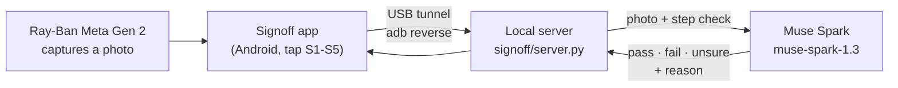

<div align="center">

# Signoff

### A second pair of eyes for anything you do with your hands.

Signoff turns a task into steps with a clear picture of *done right*, looks at each step through your **Ray-Ban Meta** glasses, and signs it off only when **Muse Spark** agrees it was done correctly.


[](https://youtu.be/HepkUTl71zw)

**[▶ Watch the 3-minute demo](https://youtu.be/HepkUTl71zw)**

| **29 / 30** | **0 / 14** | **~4 s** |
|:---:|:---:|:---:|
| photos judged correctly | wrong steps signed off | median Muse Spark answer per photo |

</div>

---

## Why Signoff

Smart glasses already see what you see. Assistants can already tell you what to do next. What nobody checks is whether you did the **last** step right: the dry pan, the shell in the egg, the whites you took off too early.

Signoff is that check. Every step has an instruction and a concrete *done right* criterion. When you finish a step, your glasses capture a photo, and Signoff answers **pass**, **fail** or **not sure**, always with a reason. The one mistake it is built never to make is the **false sign-off**: calling a wrong step done.

## How it works



1. **Plan.** A procedure is a short spec: steps, each with an instruction and a check ([`data/specs/fried-egg.json`](data/specs/fried-egg.json)).
2. **Capture.** After a step, the glasses take a photo through Meta's Wearables Device Access Toolkit and the app sends it to the local server.
3. **Judge.** The server asks Muse Spark to compare the photo with that step's check and to reply in strict JSON.
4. **Answer.** The verdict and its reason appear on the phone a few seconds later (the model call itself has a 4.1 s median). Every frame and verdict is logged for audit.

Your Meta API key lives only on your laptop. The phone reaches the server through a USB reverse tunnel, so no key is ever built into the app.

## Features

| | |
|---|---|
| **Step specs with a picture of "done right"** | Each step carries an instruction and a check the model is judged against. |
| **Glasses-first capture** | A patch to Meta's CameraAccess sample adds S1-S5 check buttons to the photo preview ([`android/`](android/)). |
| **Verdicts with reasons** | `pass`, `fail` or `unsure`, plus the model's own reason and confidence. Unparseable replies count as `unsure`, never as `pass`. |
| **Built against false sign-offs** | For video input, any failing frame fails the step and any uncertain frame keeps it open (implemented; the benchmark so far uses photos). |
| **Local, auditable server** | `POST /verify` on `127.0.0.1`, input validation, and a frame-plus-verdict log in `runs/live/`. |
| **A real benchmark** | Accuracy, false-pass, false-fail and unsure rates with Wilson 95% intervals and a per-batch breakdown ([`eval/run.py`](eval/run.py)). |
| **Zero-cost reruns** | Verdicts are cached by image, step text, model and prompt version. |

## Results

Benchmarked on 30 labeled photos of a five-step fried-egg procedure, 20 of them captured on Ray-Ban Meta glasses ([`results/report.md`](results/report.md)).

| Metric | k / n | Rate | Wilson 95% |
|---|:---:|:---:|:---:|
| Accuracy | 29 / 30 | 0.97 | 0.83 – 0.99 |
| **False-pass rate** (wrong step signed off) | **0 / 14** | **0.00** | 0.00 – 0.22 |
| False-fail rate (right step called fail) | 1 / 16 | 0.06 | 0.01 – 0.28 |
| Unsure rate | 0 / 30 | 0.00 | 0.00 – 0.11 |

| Batch | Capture | Correct |
|---|---|:---:|
| `egg1` | Ray-Ban Meta glasses, stills | 10 / 10 |
| `egg2` | Fixed camera | 10 / 10 |
| `egg4` | Ray-Ban Meta glasses, live through the app, second kitchen | 9 / 10 |

Median latency is 4.1 s per check (p95 8.0 s). More on how the data was collected and labeled is in the [dataset card](DATASET_CARD.md).

## Quickstart

**Requirements:** Python 3.11, a Meta Model API key, and ffmpeg (only for video input). For the glasses app: Android Studio, an Android phone, and Ray-Ban Meta glasses in Developer Mode.

```bash
git clone https://github.com/Kranthisai07/SignOff.git && cd SignOff
pip install -r requirements.txt
echo META_API_KEY=your_key_here > .env       # gitignored, never commit it
python -m eval.test_selfcheck                # offline self-check, prints "selfcheck ok"
```

**Verify a step from the command line**

```bash
python -m signoff.server                     # http://127.0.0.1:8000
curl -X POST "http://127.0.0.1:8000/verify?step=1" --data-binary @photo.jpg
```

```json
{
  "step": 1,
  "verdict": "fail",
  "reason": "Pan interior appears dry and matte black with no visible oil sheen, reflection, or pool.",
  "confidence": 0.85,
  "latency_ms": 5168
}
```

*(A real response, logged during the live glasses run.)*

**Use it from the glasses:** follow [`android/README.md`](android/README.md) to apply the patch, run the app on your phone, then `adb reverse tcp:8000 tcp:8000`. Capture a photo, tap the step, read the verdict.

**Run the benchmark on your own photos:** put them in `data/raw/`, list them in [`data/labels.csv`](data/labels.csv) (see [`data/sop_fried_egg.md`](data/sop_fried_egg.md)), then `python -m eval.run`.

## Defining a procedure

```json
{
  "id": 3,
  "instruction": "Cook until the whites are fully set.",
  "check": "The egg white is opaque white, not clear or glossy.",
  "failure_modes": ["raw whites"],
  "depends_on": [2]
}
```

The `check` is what Muse Spark judges the photo against. Write it as something a person could see in one glance.

## Project structure

```
signoff/
  server.py          local verify API used by the glasses app
  verifier.py        Muse Spark call, JSON parsing, verdict cache, combine rule
  meta_client.py     Meta Model API client (Responses API)
  frames.py          frame sampling from video with ffmpeg
eval/
  run.py             benchmark harness and report
  test_selfcheck.py  offline checks (scoring, intervals, frames, server validation)
android/
  signoff-glasses.patch   S1-S5 checks for Meta's CameraAccess sample
data/
  specs/fried-egg.json    the procedure spec
  labels.csv              labeled benchmark rows
results/
  report.md, results.json latest benchmark
docs/
  decisions.md       every design decision: what, why, alternatives
```

## Roadmap

- **Guided start by voice:** "Hey Meta, help me make a fried egg" builds the plan and walks you through it.
- **Any procedure:** a spec compiler that turns written instructions into step checks.
- **Continuous video:** check steps from the live stream instead of single photos (frame sampling is already in `signoff/frames.py`).
- **Sharper eyes:** SAM 3.1 crops on the object that matters, and a router that picks the cheapest model that is confident enough.

## Benchmark notes

The benchmark is small and honest by design: one annotator, still photos, two kitchen setups. One ambiguous photo was dropped before the final run (`docs/decisions.md`, D-013), and the egg photos themselves are not published, so the 29/30 figure cannot be reproduced from a clean clone. Your own photos work the same way. Per-call dollar cost is not reported because the API returns tokens, not a price.

## Privacy

Photos are taken indoors, with no faces and no screens showing private data. They are sent to the Meta Model API for judging and are subject to Meta's terms. The API key stays on your machine.

## Built with

- **Muse Spark** (`muse-spark-1.3`) through the Meta Model API: every verdict.
- **[Meta Wearables Device Access Toolkit](https://github.com/facebook/meta-wearables-dat-android)**: glasses camera access. Meta's sample app is not redistributed here; this repo ships only our patch, and the toolkit is used under the Meta Wearables Developer Terms.
- The demo video was made with HyperFrames and an ElevenLabs AI voice. Neither is part of the product.

Built during the **Meta Global AI Developer Hackathon** (Indie track). All code in this repo was written during the event.

## License

[MIT](LICENSE)
